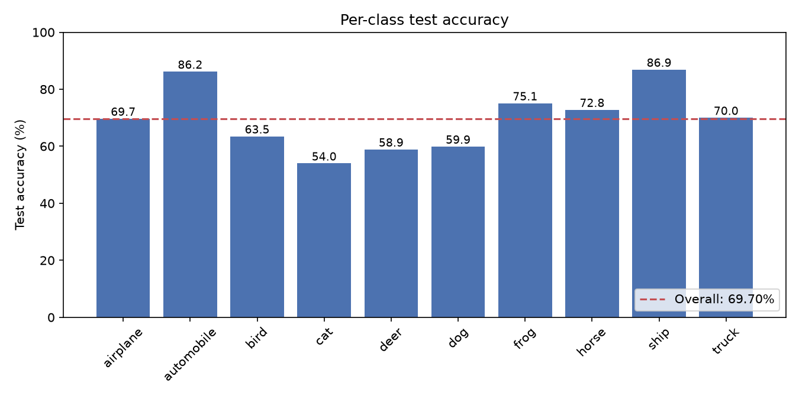
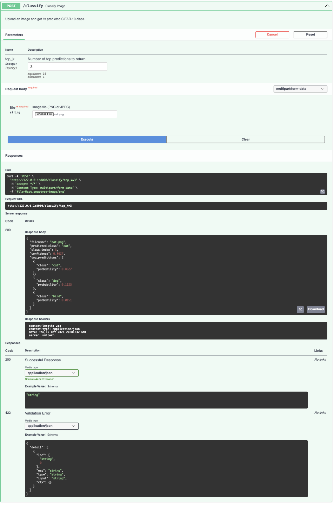
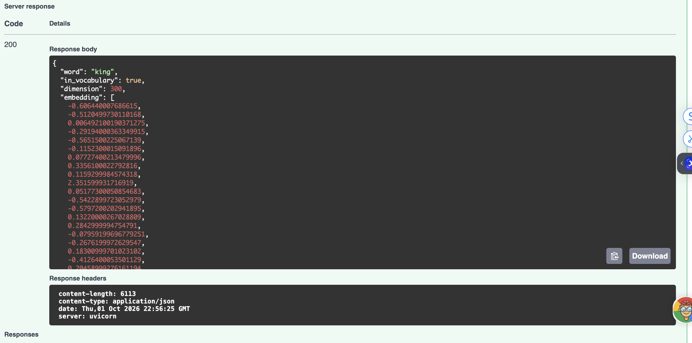

# SPS GenAI API – Assignments 1, 2 & 3

**Author:** Aqib Rahim · **Course:** Applied Generative AI

A FastAPI service with four models:

| Model | What it does | Source |
| --- | --- | --- |
| **MNIST GAN** | Generates new hand-written digits from random noise | Module 6 → **Assignment 3 (new)** |
| **CIFAR-10 CNN classifier** | Classifies an uploaded image into one of 10 CIFAR-10 classes | Module 4 → Assignment 2 |
| **spaCy word embeddings** | Returns the 300-dimensional embedding vector for a query word | Module 2 → Assignment 1 |
| **Bigram text generator** | Generates text from a start word using bigram probabilities | Module 3 class activity |

---

## Assignments (grading guide)

Each assignment builds on the same API, so they share one repository. Every assignment has its own page and a tagged snapshot of the repo exactly as submitted.

| Assignment | Topic | New endpoints | Details and results | Snapshot |
| --- | --- | --- | --- | --- |
| **Assignment 3** | GAN digit generator (MNIST) | `GET /gan/generate` (PNG), `POST /gan/generate` (JSON), `GET /gan/info` | [docs/ASSIGNMENT_3.md](docs/ASSIGNMENT_3.md) | [`assignment-3`](https://github.com/aqibrahim/sps_genai/tree/assignment-3) |
| **Assignment 2** | CNN image classifier (CIFAR-10) | `POST /classify`, `GET /classify/classes` | [docs/ASSIGNMENT_2.md](docs/ASSIGNMENT_2.md) | [`assignment-2`](https://github.com/aqibrahim/sps_genai/tree/assignment-2) |
| **Assignment 1** | spaCy word embeddings | `POST /embedding`, `GET /embedding/{word}`, `POST /similarity` | [docs/ASSIGNMENT_1.md](docs/ASSIGNMENT_1.md) | [`assignment-1`](https://github.com/aqibrahim/sps_genai/tree/assignment-1) |

The current `main` branch contains all assignments, so one `docker build` serves every endpoint.

---

## Quick start with Docker (recommended)

**Requirements:** [Docker Desktop](https://www.docker.com/products/docker-desktop/) installed and **running**. Nothing else is needed; Python, all libraries and the spaCy model are installed inside the image.

```bash
git clone https://github.com/aqibrahim/sps_genai.git
cd sps_genai
docker build -t sps-genai .
docker run -p 8000:80 sps-genai
```

- The first build takes several minutes (it downloads Python, CPU-only PyTorch, spaCy and the `en_core_web_md` model). The trained CNN and GAN weights are already in `models/`, so no training is needed.
- The server is ready when the log shows: `Uvicorn running on http://0.0.0.0:80`
- Open **http://127.0.0.1:8000/docs** in a browser.
- Stop the server with **Ctrl+C**.

The container listens on port 80 internally; `-p 8000:80` maps it to port 8000 on your machine. The image works on both Intel/AMD (x86_64) and Apple Silicon (arm64) machines.

---

## Assignment 3: GAN for hand-written digits

### Architecture (`helper_lib/model.py`, `get_model("GAN")`)

**Generator** (`Generator`, 765,761 parameters)

| Layer | Configuration | Output shape |
| --- | --- | --- |
| Input | Noise vector | (B, 100) |
| Linear | 100 → 7·7·128 | (B, 6272) |
| Reshape | | (B, 128, 7, 7) |
| ConvTranspose2d | 128 → 64, kernel 4, stride 2, padding 1 | (B, 64, 14, 14) |
| BatchNorm2d + ReLU | | (B, 64, 14, 14) |
| ConvTranspose2d | 64 → 1, kernel 4, stride 2, padding 1 | (B, 1, 28, 28) |
| Tanh | pixels in [-1, 1] | (B, 1, 28, 28) |

**Discriminator** (`Discriminator`, 138,817 parameters)

| Layer | Configuration | Output shape |
| --- | --- | --- |
| Input | Image | (B, 1, 28, 28) |
| Conv2d + LeakyReLU(0.2) | 1 → 64, kernel 4, stride 2, padding 1 | (B, 64, 14, 14) |
| Conv2d | 64 → 128, kernel 4, stride 2, padding 1 | (B, 128, 7, 7) |
| BatchNorm2d + LeakyReLU(0.2) | | (B, 128, 7, 7) |
| Flatten | | (B, 6272) |
| Linear + Sigmoid | 6272 → 1, real/fake probability | (B, 1) |

### Training

MNIST images are scaled to [-1, 1] to match the generator's Tanh output. Each batch updates the discriminator on real images (label 1) and generated images (label 0), then updates the generator with the non-saturating loss (generated images labelled 1, as in the Module 6 lecture). Adam (lr 0.0002, betas 0.5/0.999), BCE loss, batch size 128, DCGAN weight initialization:

```bash
uv run --with matplotlib python train_gan_mnist.py   # 30 epochs by default
```

It saves `models/gan_generator.pth` (used by the API), `models/gan_discriminator.pth`, `models/gan_metrics.json`, sample grids from epochs 1, 5, 10, 20 and 30 (same fixed noise, to show progress) and the loss curves in `docs/screenshots/`.

### Generate digits

**Browser:** open http://127.0.0.1:8000/gan/generate?num_images=16&seed=42 to see a PNG grid of 16 new digits. In Swagger (`/docs`), **GET /gan/generate** shows the image directly.

**curl:**

```bash
# PNG image
curl "http://127.0.0.1:8000/gan/generate?num_images=16&seed=42" -o digits.png

# JSON: base64 PNG plus the discriminator's "realness" score for each digit
curl -X POST http://127.0.0.1:8000/gan/generate \
  -H "Content-Type: application/json" \
  -d '{"num_images": 9, "seed": 42}'
```

| Parameter | Range | Meaning |
| --- | --- | --- |
| `num_images` | 1–64 (default 16) | number of digits, arranged in a square grid |
| `seed` | any integer (optional) | same seed → same digits; omit for new random digits |
| `scale` | 1–8 (default 4) | upscaling of the 28×28 digits so they are easy to see |

---

## Assignment 2: CNN image classifier

### Architecture (`helper_lib/model.py`, `get_model("CNN")`)

| Layer | Configuration | Output shape |
| --- | --- | --- |
| Input | RGB image | 3 × 64 × 64 |
| Conv2d | 16 filters, 3×3, stride 1, padding 1 | 16 × 64 × 64 |
| ReLU | | 16 × 64 × 64 |
| MaxPool2d | 2×2, stride 2 | 16 × 32 × 32 |
| Conv2d | 32 filters, 3×3, stride 1, padding 1 | 32 × 32 × 32 |
| ReLU | | 32 × 32 × 32 |
| MaxPool2d | 2×2, stride 2 | 32 × 16 × 16 |
| Flatten | | 8192 |
| Linear | 100 units | 100 |
| ReLU | | 100 |
| Linear | 10 units (CIFAR-10 classes) | 10 |

Total parameters: 825,398.

### Results

Trained for 10 epochs on the 50,000 CIFAR-10 training images (Apple M-series GPU, about 5 minutes):

| Metric | Value |
| --- | --- |
| **Test accuracy** (10,000 test images) | **69.70%** |
| Test loss | 0.8595 |
| Final training accuracy | 67.78% |

Test accuracy is slightly above training accuracy because the training images are randomly cropped and flipped (augmentation), which makes them harder than the unmodified test images. Full metrics: [`models/cifar10_cnn_metrics.json`](models/cifar10_cnn_metrics.json).

### Training

CIFAR-10 images are 32×32, so they are resized to 64×64 to match the required input size (with random crop and horizontal-flip augmentation during training). Training uses Adam (lr 0.001), cross-entropy loss and batch size 64:

```bash
uv run python train_cifar10.py              # 10 epochs by default
uv run python train_cifar10.py --epochs 15  # optional
```

The script downloads CIFAR-10 to `data/` (not committed), trains the CNN, evaluates it on the 10,000 test images, and writes:

- `models/cifar10_cnn.pth`: trained weights used by the API (committed, so the Docker image works without retraining)
- `models/cifar10_cnn_metrics.json`: test loss and accuracy
- `sample_images/`: one CIFAR-10 test image per class, for trying the API

### Detailed evaluation

`evaluate_cifar10.py` loads the trained model (no retraining) and measures per-class accuracy, a confusion matrix and the most common mistakes on the 10,000 test images:

```bash
uv run --with matplotlib python evaluate_cifar10.py
```

It saves `models/cifar10_cnn_evaluation.json` and the charts `docs/screenshots/confusion_matrix.png` and `docs/screenshots/per_class_accuracy.png`.

**Result:** best classes are ship (86.9%) and automobile (86.2%); hardest are cat (54.0%), deer (58.9%) and dog (59.9%). The most common mistake is dog → cat (198 images). Full table and interpretation: [docs/ASSIGNMENT_2.md](docs/ASSIGNMENT_2.md#detailed-evaluation).



### Classify an image

**Browser:** open http://127.0.0.1:8000/docs → **POST /classify** → **Try it out** → **Choose File** (e.g. `sample_images/cat.png`) → **Execute**.

**curl:**

```bash
curl -X POST "http://127.0.0.1:8000/classify?top_k=3" \
  -F "file=@sample_images/cat.png"
```

Response format:

```json
{
  "filename": "cat.png",
  "predicted_class": "cat",
  "class_index": 3,
  "confidence": 0.71,
  "top_predictions": [
    {"class": "cat", "probability": 0.71},
    {"class": "dog", "probability": 0.18},
    {"class": "frog", "probability": 0.04}
  ]
}
```

Any PNG or JPEG of any size works. Uploaded images are shrunk to 32×32 and upscaled to 64×64, the same way the training images were prepared. The model only knows the 10 CIFAR-10 classes (airplane, automobile, bird, cat, deer, dog, frog, horse, ship, truck), so photos of other things are still assigned to the closest of these.

---

## Verified results

**Assignment 2:** the CNN reaches **69.70% test accuracy** on CIFAR-10. Through the Docker container, `POST /classify` with `sample_images/cat.png` returns **cat** with 86.27% confidence:



**Assignment 1:** `POST /embedding` with `{"word": "king"}` returns the 300-dimensional vector:



Full results and screenshots: **[Assignment 2](docs/ASSIGNMENT_2.md)** · **[Assignment 1](docs/ASSIGNMENT_1.md)**.

---

## Testing the API

### Option A: Browser (Swagger UI)

1. Open **http://127.0.0.1:8000/docs**.
2. Click **POST /embedding** → **Try it out**.
3. Replace the request body with `{"word": "king"}` and click **Execute**.
4. Expected: response code **200** with `"dimension": 300` and a list of 300 numbers.

Quickest check: open **http://127.0.0.1:8000/embedding/apple** directly in the browser.

### Option B: Command line (curl)

**Word embedding** (Assignment 1 endpoint):

```bash
curl -X POST http://127.0.0.1:8000/embedding \
  -H "Content-Type: application/json" \
  -d '{"word": "king"}'
```

Expected response (vector shortened here):

```json
{
  "word": "king",
  "in_vocabulary": true,
  "dimension": 300,
  "embedding": [-0.6064, -0.5120, 0.0065, -0.2919, ...]
}
```

**Word similarity:**

```bash
curl -X POST http://127.0.0.1:8000/similarity \
  -H "Content-Type: application/json" \
  -d '{"word1": "king", "word2": "queen"}'
```

Expected: `{"word1": "king", "word2": "queen", "similarity": 0.38...}`

**Bigram text generation:**

```bash
curl -X POST http://127.0.0.1:8000/generate \
  -H "Content-Type: application/json" \
  -d '{"start_word": "the", "length": 8}'
```

Expected (output is random, so it varies each call): `{"generated_text": "the count of monte cristo is a novel"}`

---

## Endpoints

| Method | Path | Request | Response |
| --- | --- | --- | --- |
| GET | `/` | – | `{"Hello": "World"}` (health check) |
| POST | `/embedding` | `{"word": "king"}` | `word`, `in_vocabulary`, `dimension`, `embedding` (list of 300 floats) |
| GET | `/embedding/{word}` | word in the URL | same as `POST /embedding` |
| POST | `/similarity` | `{"word1": "king", "word2": "queen"}` | cosine similarity between the two word vectors |
| GET | `/gan/generate` | query `num_images` (1–64), `seed`, `scale` (1–8) | PNG image grid of generated digits |
| POST | `/gan/generate` | `{"num_images": 9, "seed": 42}` | `image_base64` (PNG), `discriminator_scores`, `image_shape` |
| GET | `/gan/info` | – | GAN architecture summary |
| POST | `/classify` | image file upload (form field `file`), optional `?top_k=1..10` | `predicted_class`, `class_index`, `confidence`, `top_predictions` |
| GET | `/classify/classes` | – | the 10 class names and the model's test accuracy |
| POST | `/generate` | `{"start_word": "the", "length": 10}` | `generated_text` (`length` must be 1–100) |

**Input rules and errors**

- `/embedding` accepts **one word**. Multi-word input such as `"two words"` returns **400** with `{"detail": "Please provide a single word."}`.
- `/classify` with a file that is not an image returns **400**; a missing file or `top_k` outside 1–10 returns **422**.
- If `models/cifar10_cnn.pth` is missing, `/classify` returns **503** with instructions to run the training script.
- Missing or invalid fields return **422** (FastAPI validation error).
- A word not in spaCy's vocabulary still returns **200**, with `"in_vocabulary": false` and an all-zero vector.

---

## How it works

- **Embeddings** (`app/embedding_model.py`): loads spaCy's `en_core_web_md` model once at startup. For a query word it returns the token's static 300-dimensional vector (`token.vector`). Similarity is the cosine similarity of two word vectors (`token.similarity`).
- **Bigram model** (`app/bigram_model.py`): tokenizes a small corpus, counts word pairs, and converts them to conditional probabilities P(next word | current word). Generation samples each next word from those probabilities, stopping early if a word has no known continuation.
- **CNN classifier** (`helper_lib/`, `app/image_classifier.py`): the Module 4 helper library holds the data loading, model definitions, training loop and evaluation. `train_cifar10.py` uses it to train the Assignment 2 CNN; the API loads the saved weights once at startup and runs inference on uploaded images.
- **API** (`app/main.py`): FastAPI routes with Pydantic request models for input validation.

PyTorch is installed from the official CPU-only index on Linux (inside Docker), which keeps the image smaller and needs no GPU on the grader's machine; macOS and Windows use the regular PyPI build. The spaCy model is pinned as a dependency in `pyproject.toml` and locked in `uv.lock`, so `uv sync` (and the Docker build) installs it automatically. No separate `python -m spacy download` step is needed.

---

## Project structure

```
sps_genai/
├── app/
│   ├── __init__.py
│   ├── main.py              # FastAPI app and endpoints
│   ├── digit_generator.py   # MNIST GAN generation wrapper (Assignment 3)
│   ├── image_classifier.py  # CIFAR-10 inference wrapper (Assignment 2)
│   ├── embedding_model.py   # spaCy word-embedding model (Assignment 1)
│   └── bigram_model.py      # Bigram text generator (Module 3)
├── helper_lib/              # Reusable neural-network library (Module 4)
│   ├── data_loader.py       # CIFAR-10 and MNIST loaders and transforms
│   ├── model.py             # FCNN, CNN (A2), EnhancedCNN, GAN Generator/Discriminator (A3)
│   ├── trainer.py           # Training loops (classifier and GAN)
│   ├── generator.py         # GAN sampling and image grids
│   ├── evaluator.py         # Test loss and accuracy
│   └── utils.py             # Save/load model, device selection
├── models/
│   ├── gan_generator.pth    # Trained GAN generator (and discriminator, metrics)
│   ├── cifar10_cnn.pth      # Trained CNN weights
│   └── cifar10_cnn_metrics.json
├── sample_images/           # One CIFAR-10 test image per class
├── train_gan_mnist.py       # Trains the GAN on MNIST (Assignment 3)
├── train_cifar10.py         # Trains the CNN and saves it to models/
├── evaluate_cifar10.py      # Per-class accuracy and confusion matrix
├── tests/                   # pytest: architecture, helper library, API endpoints
├── Dockerfile
├── pyproject.toml           # Dependencies (CPU-only PyTorch on Linux/Docker)
├── uv.lock
├── probability_solutions.py # Assignment 1 Part 2 calculation checks
├── docs/                    # ASSIGNMENT_1/2/3.md, screenshots
└── README.md
```

---

## Automated tests

The `tests/` folder checks the CNN (Assignment 2) and the GAN generator and discriminator (Assignment 3) layer by layer against the assignment specs, the helper library, and every API endpoint (including error cases):

```bash
uv run --with pytest pytest -v
```

`--with pytest` adds pytest only for this command, so it is not installed in the Docker image.

---

## Running without Docker (optional)

Requires [uv](https://docs.astral.sh/uv/getting-started/installation/) and Python 3.12+.

```bash
uv sync
uv run fastapi dev app/main.py
```

Then open http://127.0.0.1:8000/docs.

---

## Troubleshooting

| Problem | Fix |
| --- | --- |
| `failed to connect to the docker API` / `Cannot connect to the Docker daemon` | Docker Desktop isn't running. Open it and wait until the whale icon stops animating, then retry. |
| `docker build requires 1 argument` | Add the `.` at the end: `docker build -t sps-genai .` |
| `port is already allocated` | Port 8000 is in use. Run on another port: `docker run -p 8001:80 sps-genai`, then open http://127.0.0.1:8001/docs |
| Page doesn't load right after `docker run` | Wait for the `Uvicorn running` log line; the spaCy model takes a few seconds to load. |
| `/gan/generate` returns 503 | `models/gan_generator.pth` is missing. Run `uv run python train_gan_mnist.py`, then rebuild the Docker image. |
| `/classify` returns 503 | `models/cifar10_cnn.pth` is missing. Run `uv run python train_cifar10.py`, then rebuild the Docker image. |
| `"in_vocabulary": false` | The word isn't in spaCy's vocabulary. Try a common English word such as `king`, `apple` or `computer`. |
