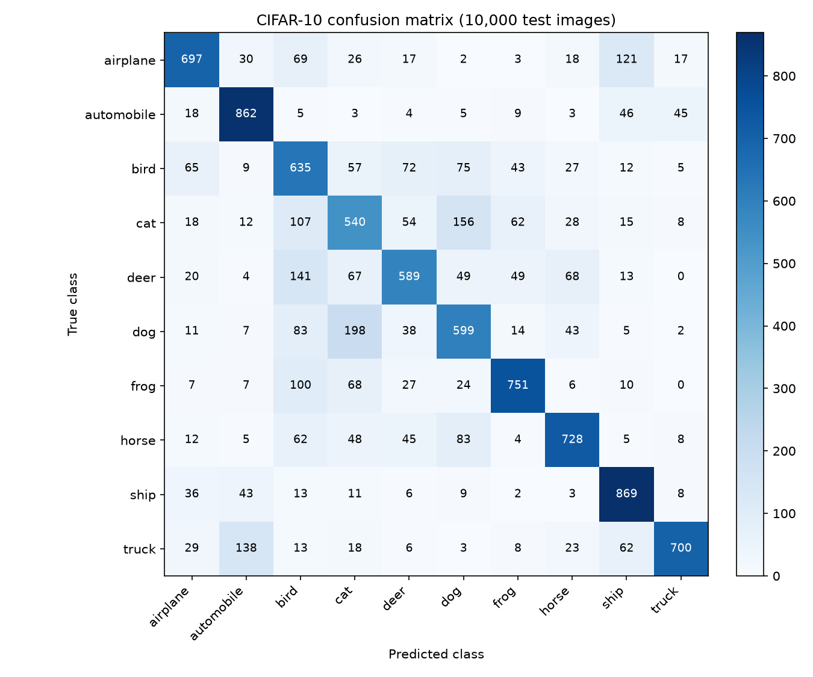
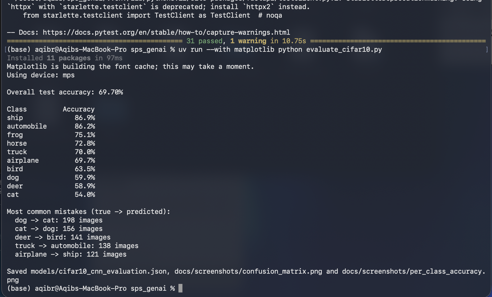
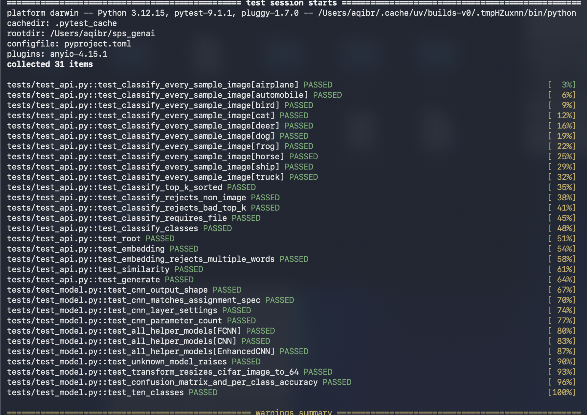
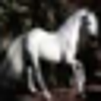

# Assignment 2: CNN Image Classifier

**Author:** Aqib Rahim · **Snapshot:** [`assignment-2` tag](https://github.com/aqibrahim/sps_genai/tree/assignment-2)

## What was asked

1. **Practice: CNN architecture.** Implement in PyTorch a CNN for 64×64×3 input: Conv(16, 3×3, s1, p1) → ReLU → MaxPool(2×2, s2) → Conv(32, 3×3, s1, p1) → ReLU → MaxPool(2×2, s2) → Flatten → FC(100) → ReLU → FC(10).
2. **Practice: model deployment.** Train it on CIFAR-10, add the classifier to the API, and commit to GitHub.
3. **Theory: arithmetic of CNNs.** Submitted as a PDF on Canvas.

## Where to find it

| Part | File |
| --- | --- |
| CNN architecture | [`helper_lib/model.py`](../helper_lib/model.py), class `CNN` (`get_model("CNN")`) |
| Helper library (Module 4) | [`helper_lib/`](../helper_lib): data loader, trainer, evaluator, utils |
| Training script | [`train_cifar10.py`](../train_cifar10.py) |
| Trained model | [`models/cifar10_cnn.pth`](../models), metrics in [`models/cifar10_cnn_metrics.json`](../models/cifar10_cnn_metrics.json) |
| Inference wrapper | [`app/image_classifier.py`](../app/image_classifier.py) |
| API endpoints | [`app/main.py`](../app/main.py): `POST /classify`, `GET /classify/classes` |
| Test images | [`sample_images/`](../sample_images): one CIFAR-10 test image per class |

## How to test

```bash
git clone https://github.com/aqibrahim/sps_genai.git
cd sps_genai
docker build -t sps-genai .
docker run -p 8000:80 sps-genai
```

Then open http://127.0.0.1:8000/docs → **POST /classify** → **Try it out** → choose `sample_images/cat.png` → **Execute**, or:

```bash
curl -X POST "http://127.0.0.1:8000/classify?top_k=3" -F "file=@sample_images/cat.png"
```

The architecture table and training details are in the [README](../README.md#assignment-2-cnn-image-classifier).


## Training output

```
Using device: mps
Epoch 1/10 - loss: 1.5771 - train acc: 42.53%
Epoch 2/10 - loss: 1.2939 - train acc: 53.16%
Epoch 3/10 - loss: 1.1660 - train acc: 58.42%
Epoch 4/10 - loss: 1.0922 - train acc: 60.91%
Epoch 5/10 - loss: 1.0412 - train acc: 62.95%
Epoch 6/10 - loss: 0.9998 - train acc: 64.59%
Epoch 7/10 - loss: 0.9658 - train acc: 65.68%
Epoch 8/10 - loss: 0.9470 - train acc: 66.43%
Epoch 9/10 - loss: 0.9278 - train acc: 67.42%
Epoch 10/10 - loss: 0.9141 - train acc: 67.78%
Test loss: 0.8595 - Test accuracy: 69.70%
Saved model to models/cifar10_cnn.pth and metrics to models/cifar10_cnn_metrics.json
Saved 10 sample images to sample_images/
```

**Result:** the Assignment 2 CNN reaches **69.70% accuracy** on the 10,000 CIFAR-10 test images (random guessing would be 10%). ✅

## Detailed evaluation

From `uv run --with matplotlib python evaluate_cifar10.py`, using the trained model on the 10,000 CIFAR-10 test images:

| Class | Test accuracy |
| --- | --- |
| ship | 86.9% |
| automobile | 86.2% |
| frog | 75.1% |
| horse | 72.8% |
| truck | 70.0% |
| airplane | 69.7% |
| bird | 63.5% |
| dog | 59.9% |
| deer | 58.9% |
| cat | 54.0% |
| **Overall** | **69.70%** |

**Most common mistakes (true → predicted):**

| True class | Predicted as | Images |
| --- | --- | --- |
| dog | cat | 198 |
| cat | dog | 156 |
| deer | bird | 141 |
| truck | automobile | 138 |
| airplane | ship | 121 |

**Interpretation.** The model is strongest on classes with distinctive shapes and backgrounds: ships (water), automobiles, and frogs. It struggles most with cats, dogs and deer. The top two mistakes are cats and dogs confused with each other: at 32×32 resolution both are furry, four-legged animals of similar size and pose, and this small two-layer CNN does not have the capacity to learn the finer facial features that separate them. The other frequent mistakes also pair visually similar classes: deer and birds (brown animals on green or natural backgrounds), trucks and automobiles (both vehicles on roads), and airplanes and ships (objects against a plain blue sky or sea). The confusion matrix also shows that **bird** is the model's most common wrong guess overall (its column has the most off-diagonal predictions): deer (141), cats (107) and frogs (100) are often labelled as birds, so for small animals with unclear shapes the model tends to fall back on "bird". These errors suggest that a deeper network with more filters, such as the EnhancedCNN in the helper library, would mainly improve the animal classes.

**Confusion matrix** (rows = true class, columns = predicted class; the diagonal holds the 6,970 correct predictions):



**Per-class accuracy** (dashed line = overall 69.70%):


Raw numbers: [`models/cifar10_cnn_evaluation.json`](../models/cifar10_cnn_evaluation.json).

Terminal output:



## Automated tests

`uv run --with pytest pytest -v` runs 31 tests: the CNN checked layer by layer against the assignment spec, its layer settings and parameter count (825,398), all helper-library models, the image transforms, all 10 sample images through `POST /classify`, the error cases (400/422), and the Assignment 1 endpoints.

**Result: 31 passed.** ✅ (The one warning comes from FastAPI's test client library, not from this project.)



## Sample images for testing `/classify`

One CIFAR-10 test image per class, in [`sample_images/`](../sample_images):

| | | | | |
| --- | --- | --- | --- | --- |
| <br>airplane | <br>automobile | <br>bird | <br>cat | <br>deer |
| <br>dog | <br>frog | <br>horse | <br>ship | <br>truck |

## `POST /classify` through Docker

Request: `cat.png` from `sample_images/`, `top_k=3`, sent from the Swagger UI of the Docker container (`docker run -p 8000:80 sps-genai`).

**Response: `200 OK`**

```json
{
  "filename": "cat.png",
  "predicted_class": "cat",
  "class_index": 3,
  "confidence": 0.8627,
  "top_predictions": [
    {"class": "cat", "probability": 0.8627},
    {"class": "dog", "probability": 0.1123},
    {"class": "bird", "probability": 0.0151}
  ]
}
```

**Result:** correctly classified as **cat** with 86.27% confidence; the runner-up classes (dog, bird) are the visually closest ones. ✅


