# Assignment 3: Image Generation with a GAN

**Author:** Aqib Rahim · **Course:** Applied Generative AI · **Snapshot:** [`assignment-3` tag](https://github.com/aqibrahim/sps_genai/tree/assignment-3)

## What was asked

1. **Practice: GAN architecture.** Implement a GAN in PyTorch matching the given generator (noise 100 → FC 7×7×128 → ConvT 128→64 + BN + ReLU → ConvT 64→1 + Tanh) and discriminator (Conv 1→64 + LeakyReLU(0.2) → Conv 64→128 + BN + LeakyReLU(0.2) → Flatten → Linear to one real/fake output).
2. **Practice: model deployment.** Train the GAN on MNIST to generate hand-written digits, add it to the API, and commit to GitHub.
3. **Theory: building blocks of GANs.** Submitted as a PDF on Canvas.

## Where to find it

| Part | File |
| --- | --- |
| Generator and discriminator | [`helper_lib/model.py`](../helper_lib/model.py): classes `Generator`, `Discriminator`, `GAN` (`get_model("GAN")`) |
| MNIST data loader | [`helper_lib/data_loader.py`](../helper_lib/data_loader.py): `get_mnist_loader` (pixels scaled to [-1, 1]) |
| GAN training loop | [`helper_lib/trainer.py`](../helper_lib/trainer.py): `train_gan` |
| Sampling and image grids | [`helper_lib/generator.py`](../helper_lib/generator.py) |
| Training script | [`train_gan_mnist.py`](../train_gan_mnist.py) |
| Trained models | [`models/gan_generator.pth`](../models), [`models/gan_discriminator.pth`](../models), [`models/gan_metrics.json`](../models/gan_metrics.json) |
| API wrapper and endpoints | [`app/digit_generator.py`](../app/digit_generator.py), [`app/main.py`](../app/main.py): `GET /gan/generate`, `POST /gan/generate`, `GET /gan/info` |
| Tests | [`tests/test_gan.py`](../tests/test_gan.py) |

The architecture tables (every layer with its output shape) are in the [README](../README.md#assignment-3-gan-for-hand-written-digits).

## How to test

```bash
git clone https://github.com/aqibrahim/sps_genai.git
cd sps_genai
docker build -t sps-genai .
docker run -p 8000:80 sps-genai
```

Then open **http://127.0.0.1:8000/gan/generate?num_images=16&seed=42** in a browser to see 16 generated digits, or use **GET /gan/generate** and **POST /gan/generate** in http://127.0.0.1:8000/docs.

## Training

30 epochs on the 60,000 MNIST training images (Apple M-series GPU): Adam (lr 0.0002, betas 0.5/0.999), BCE loss with the non-saturating generator loss from the Module 6 lecture, batch size 128, DCGAN weight initialization, random seed 42.

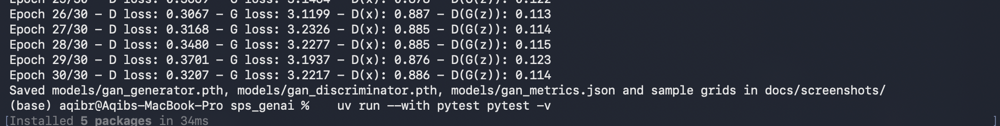

| Metric (epoch 30) | Value |
| --- | --- |
| Discriminator loss | 0.3207 |
| Generator loss | 3.2217 |
| D(x): mean output on real digits | 0.886 |
| D(G(z)): mean output on generated digits | 0.114 |
| Generator / discriminator parameters | 765,761 / 138,817 |

Full per-epoch history: [`models/gan_metrics.json`](../models/gan_metrics.json).

## Results

### Training progress (same 64 noise vectors at every snapshot)

| Epoch 1 | Epoch 5 | Epoch 10 | Epoch 20 | Epoch 30 |
| --- | --- | --- | --- | --- |
| 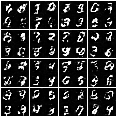 | 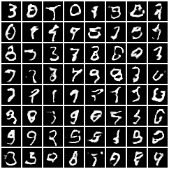 | 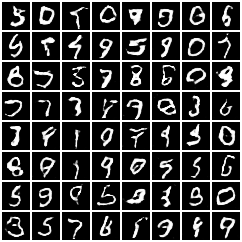 | 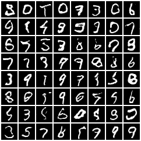 | 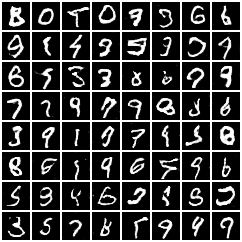 |

Because the input noise is fixed, each grid position shows how the *same* sample evolves. After epoch 1 the outputs are blurry, noisy blobs with only rough digit outlines. By epoch 5 most samples are recognizable digits, and from epoch 10 to 30 the strokes become thinner, smoother and more consistent, with fewer broken or extra marks. Early on, some samples still change which digit they show (the top-left sample is a 3 at epoch 5 and a 5 at epoch 10), but by epoch 20 each sample has settled on a stable identity (the top-left becomes an 8 and stays an 8 at epoch 30, just cleaner). This shows the generator converging to a stable mapping from noise to digits.

### Final samples (64 new digits, different noise)

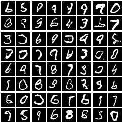

All ten digits (0–9) appear with varied slant, thickness and style, so the generator has **not mode-collapsed** (mode collapse would show the same few digits repeated). Some samples are still imperfect, for example ambiguous 4/9 shapes or incomplete loops, which is expected for a small two-layer generator trained for 30 epochs.

### Training curves

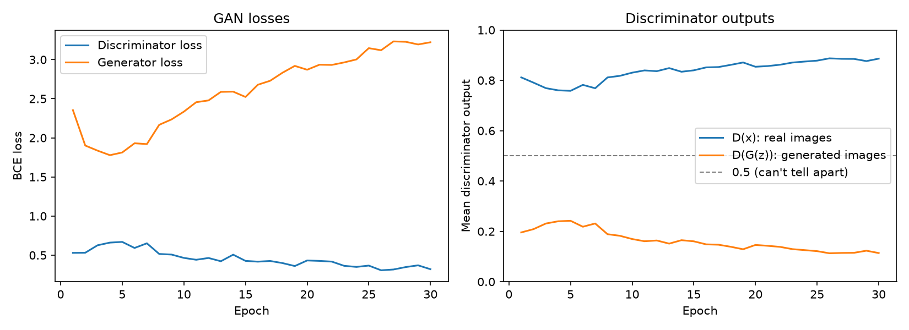

**Interpretation.**

- **Two phases.** In the first 5 epochs the generator catches up quickly: D(G(z)) rises from 0.20 to its peak of 0.24 and D(x) dips from 0.81 to 0.76, so the discriminator is briefly less sure. After that the discriminator pulls ahead again: by epoch 30, D(x) = 0.89 and D(G(z)) = 0.11, so it separates real from generated digits more confidently. A perfect equilibrium would put both near 0.5.
- **The generator loss rises, but the images improve.** The generator loss, −log D(G(z)), falls from 2.35 to its lowest point of 1.78 at epoch 4 and then grows to 3.22 by epoch 30 because the discriminator keeps getting better at spotting fakes. In a GAN the losses measure each network *against the other*, not absolute quality: the generator is improving, but the discriminator improves slightly faster. The sample grids are the real measure of quality, and they get steadily better.
- **Training is stable.** There is no collapse (the discriminator loss never goes to 0 and D(G(z)) never goes to 0), no oscillation, and no mode collapse. The non-saturating loss is what keeps the generator learning here: even with D(G(z)) ≈ 0.11, −log D(G(z)) still gives a strong gradient, whereas the original log(1 − D(G(z))) loss would give a very weak one (the vanishing-gradient problem from the lecture).
- **Possible improvements:** one-sided label smoothing (real label 0.9) or a slightly larger generator would balance the two networks; longer training would sharpen the remaining imperfect digits.

## API tests through Docker

**Browser:** `GET /gan/generate?num_images=16&seed=42` returns a PNG grid of new digits:

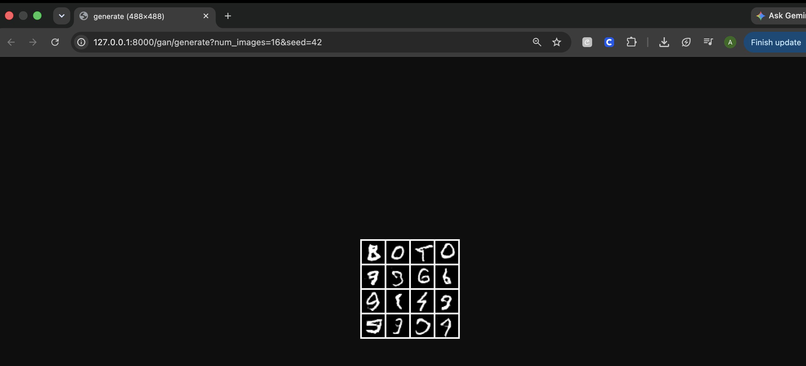

**Swagger, GET /gan/generate:** the same seed returns the identical grid, showing generation is reproducible:

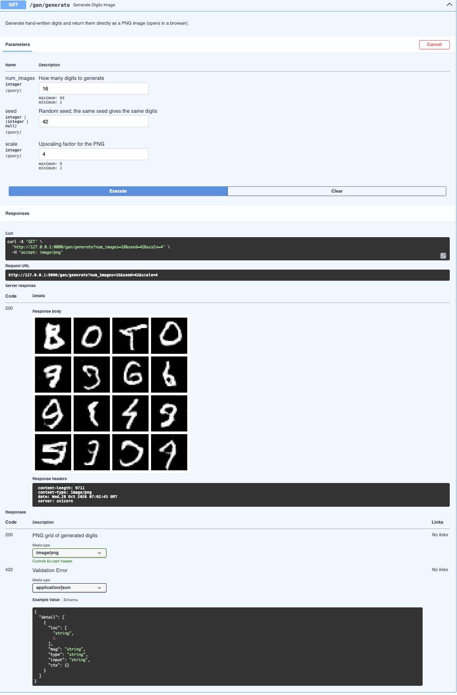

**Swagger, POST /gan/generate** with `{"num_images": 9, "seed": 42}`: returns `200` with the PNG as base64, plus the discriminator's probability that each digit is real:

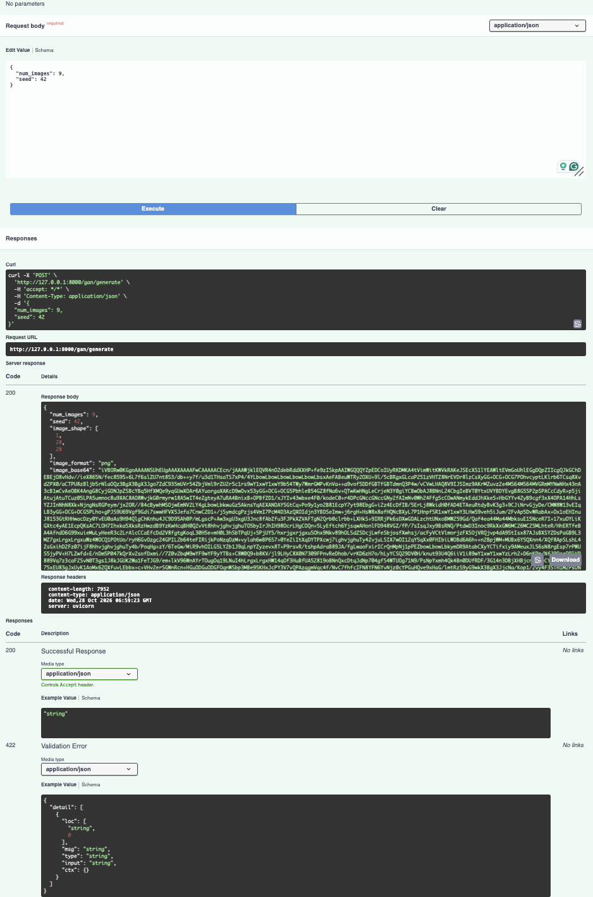

## Automated tests

`uv run --with pytest pytest -v` runs **46 tests, all passing**. The 15 new Assignment 3 tests check every generator and discriminator layer's output shape and settings against the spec (kernel 4, stride 2, padding 1, LeakyReLU slope 0.2, BatchNorm placement), the Tanh output range, the sigmoid probability output, the parameter counts, seed reproducibility, and the `/gan` endpoints (PNG size, JSON format, input validation).

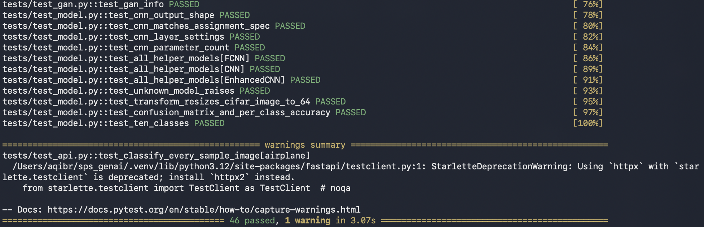
