# Assignment 4: Advanced Image Generation (Diffusion and Energy-Based Models)

**Author:** Aqib Rahim · **Course:** Applied Generative AI · **Snapshot:** [`assignment-4` tag](https://github.com/aqibrahim/sps_genai/tree/assignment-4)

## What was asked

1. **Practice: model deployment.** Train an **energy-based model** and a **diffusion model** on CIFAR-10 and add them to the API from the Module 6 class activity; commit to GitHub.
2. **Theory: building blocks of a diffusion model** (sinusoidal embeddings, U-Net, loss): submitted as a PDF on Canvas.
3. **Theory: building blocks of an energy model** (PyTorch autograd): submitted as a PDF on Canvas; every answer is also checked by [`tests/test_autograd.py`](../tests/test_autograd.py).

The API builds on the class activities:

| Activity | What it adds | Where |
| --- | --- | --- |
| Module 6/7: adding an RNN to the text-generation API | LSTM next-word model and `POST /generate_with_rnn` (replacing the bigram generator from Module 3) | `LSTMLanguageModel`, `train_lstm`, `generate_with_rnn` |
| Module 8: adding diffusion to the helper library | `get_model("Diffusion")`, `train_diffusion(model, data_loader, criterion, optimizer, device, epochs)`, `generate_samples(model, device, num_samples, diffusion_steps)` | `helper_lib/model.py`, `trainer.py`, `generator.py` |
| Assignment 4 | Energy-based model with Langevin sampling, plus diffusion and EBM endpoints | `EnergyModel`, `train_ebm`, `langevin_sample` |

## Where to find it

| Part | File |
| --- | --- |
| U-Net, sinusoidal embedding, DDPM objective | [`helper_lib/model.py`](../helper_lib/model.py): `SinusoidalEmbedding`, `ResidualBlock`, `DownBlock`, `UpBlock`, `UNet`, `DiffusionModel` |
| Energy model | [`helper_lib/model.py`](../helper_lib/model.py): `EnergyModel` |
| LSTM language model | [`helper_lib/model.py`](../helper_lib/model.py): `LSTMLanguageModel`; text utilities in [`helper_lib/text.py`](../helper_lib/text.py) |
| Training loops | [`helper_lib/trainer.py`](../helper_lib/trainer.py): `train_diffusion`, `train_ebm`, `train_lstm` |
| Sampling | [`helper_lib/generator.py`](../helper_lib/generator.py): `generate_diffusion_samples` (DDIM), `langevin_sample`, `generate_ebm_samples`, `generate_with_rnn`, `generate_samples` |
| Training scripts | [`train_diffusion_cifar10.py`](../train_diffusion_cifar10.py), [`train_ebm_cifar10.py`](../train_ebm_cifar10.py), [`train_lstm_text.py`](../train_lstm_text.py) |
| Trained models and metrics | [`models/`](../models): `diffusion_unet.pth`, `ebm.pth`, `lstm_text.pth` and the matching `*_metrics.json` |
| API | [`app/main.py`](../app/main.py): imports `UNet`, `DiffusionModel`, `EnergyModel` and `LSTMLanguageModel` from `helper_lib.model` and builds them with the architectures below |
| Tests | [`tests/test_diffusion_ebm.py`](../tests/test_diffusion_ebm.py), [`tests/test_autograd.py`](../tests/test_autograd.py), [`tests/test_lstm.py`](../tests/test_lstm.py) |

## How to test

```bash
git clone https://github.com/aqibrahim/sps_genai.git
cd sps_genai
docker build -t sps-genai .
docker run -p 8000:80 sps-genai
```

| Endpoint | Try it |
| --- | --- |
| `GET /diffusion/generate` | http://127.0.0.1:8000/diffusion/generate?num_images=16&seed=42 (PNG grid) |
| `POST /diffusion/generate` | `{"num_images": 9, "steps": 50, "seed": 42}` → base64 PNG |
| `GET /ebm/generate` | http://127.0.0.1:8000/ebm/generate?num_images=16&seed=42 (PNG grid) |
| `POST /ebm/generate` | `{"num_images": 9, "seed": 42}` → base64 PNG plus each image's energy before and after Langevin sampling |
| `POST /generate_with_rnn` | `{"start_word": "the count", "length": 30, "seed": 1}` → generated text |
| `GET /diffusion/info`, `GET /ebm/info` | the loaded models' actual layers and parameter counts |

---

## Part 1a: Diffusion model

### Step 1: Data

`get_cifar10_generation_loader` loads the 50,000 CIFAR-10 training images (3×32×32) with random horizontal flips, scaled to **[−1, 1]** so that clean images and Gaussian noise live on comparable scales. Class labels are ignored: the model learns the image distribution itself.

### Step 2: The forward (noising) process

A **cosine noise schedule** over T = 1,000 timesteps defines the cumulative signal rate ᾱ_t, from ≈1 (clean) at t = 0 to ≈0 (pure noise) at t = 999. Any noisy version of an image can be computed in one step:

x_t = √ᾱ_t · x₀ + √(1 − ᾱ_t) · ε,  ε ~ N(0, I)

The cosine schedule (Nichol & Dhariwal, 2021) destroys information more gradually than a linear schedule, which matters for small 32×32 images.

### Step 3: U-Net denoiser (1,950,627 parameters)

The U-Net receives the noisy image x_t **and** the timestep t, and predicts the noise ε that was added.

| Stage | Operation | Output |
| --- | --- | --- |
| Time embedding | sinusoidal embedding of t (32 dims, max period 10,000), upsampled to 32×32 | 32 × 32 × 32 |
| Input | Conv1×1 (3 → 32) on the image, concatenated with the time embedding | 64 × 32 × 32 |
| Down 1 | 2 residual blocks → AvgPool | 32 × 16 × 16 |
| Down 2 | 2 residual blocks → AvgPool | 64 × 8 × 8 |
| Down 3 | 2 residual blocks → AvgPool | 96 × 4 × 4 |
| Bottleneck | 2 residual blocks | 128 × 4 × 4 |
| Up 1–3 | Upsample ×2 → concatenate the matching skip connections → 2 residual blocks | 96×8×8 → 64×16×16 → 32×32×32 |
| Output | Conv1×1 (32 → 3), zero-initialized | 3 × 32 × 32 (predicted noise) |

Each residual block is BatchNorm → Conv3×3 + Swish → Conv3×3, plus a skip connection (1×1 conv when the channel count changes). The **skip connections** carry fine detail from the down path directly to the up path, so the bottleneck only needs to capture global structure. The time embedding uses exactly the formula from Part 2, Question 1; a test confirms it reproduces the Question 2 values for t = 1.

### Step 4: Training (`train_diffusion`)

For each batch: sample a random t for every image, build x_t in closed form, predict ε with the U-Net, and minimize **MSE(ε̂, ε)**, the DDPM objective (Part 2, Question 5). AdamW (lr 0.001, weight decay 1e-4), batch size 128, 15 epochs. An **exponential moving average** (EMA, decay 0.999) of the weights is kept and used for generation, because it averages out the noise of individual updates and gives cleaner samples.

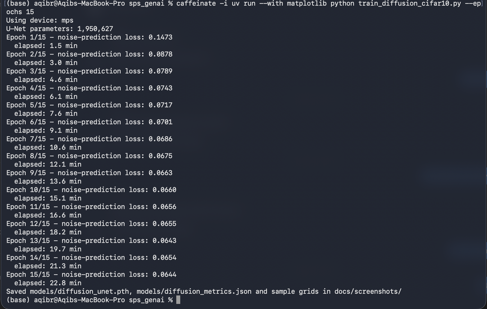

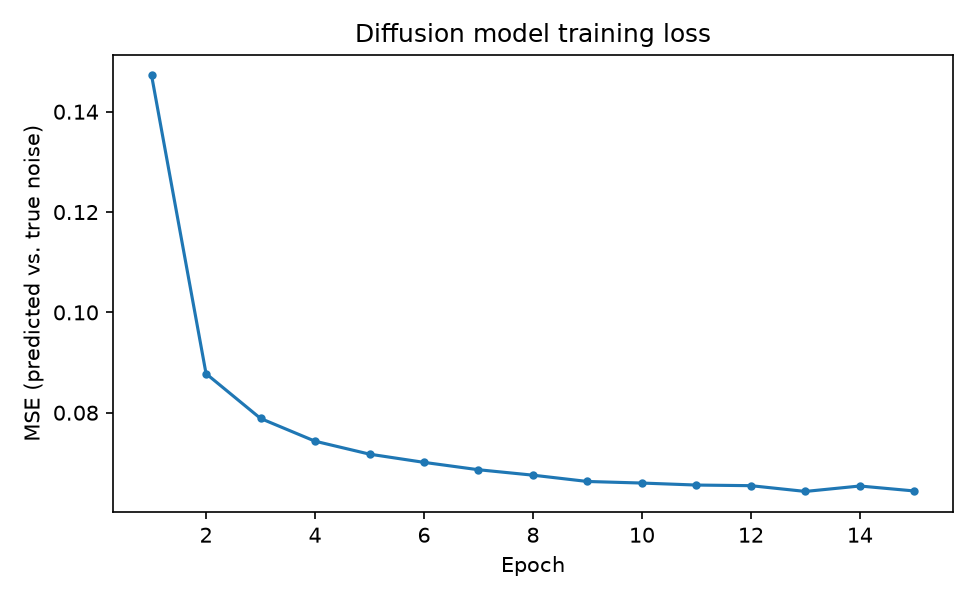

The loss falls quickly from 0.147 to 0.088 in epoch 2 (the model learns the overall image statistics), then slowly to **0.064** as it refines detail. Training took 22.9 minutes on an Apple M-series GPU.

### Step 5: Generation with DDIM

Starting from pure noise x_T ~ N(0, I), the **DDIM** sampler (deterministic, 50 steps instead of 1,000) repeats:

1. predict the noise: ε̂ = U-Net(x_t, t)
2. estimate the clean image: x̂₀ = (x_t − √(1−ᾱ_t) ε̂) / √ᾱ_t, clamped to [−1, 1]
3. recompute the noise consistent with the clamped x̂₀: ε̂ = (x_t − √ᾱ_t x̂₀) / √(1−ᾱ_t)
4. step to the less noisy timestep s: x_s = √ᾱ_s x̂₀ + √(1−ᾱ_s) ε̂

### Results

**Progress during training** (same noise, snapshots taken during training):

| Epoch 1 | Epoch 5 | Epoch 10 |
| --- | --- | --- |
| 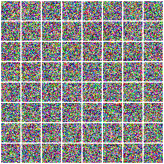 | 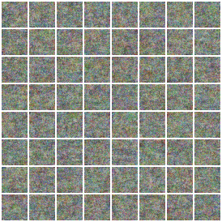 | 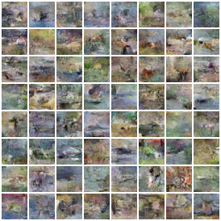 |

At epoch 1 the model cannot yet denoise (pure noise); by epoch 5 it removes the colour noise but produces only grey texture; by epoch 10 coherent scenes appear, with sky, ground, water and animal-like shapes and natural CIFAR-10 colours.

**A sampler bug found and fixed (step 3 above).** The first version of the sampler skipped step 3. At the noisiest timesteps ᾱ_t ≈ 0, so the estimate x̂₀ is huge and gets clamped; the old, unclamped ε̂ then no longer matched it, and a few samples blew up into saturated checkerboard patterns. Recomputing ε̂ from the clamped x̂₀ (as the `diffusers` library's DDIM sampler does) fixes this **without retraining**:

| Epoch 15, original sampler (during training) | Final model, fixed sampler |
| --- | --- |
| 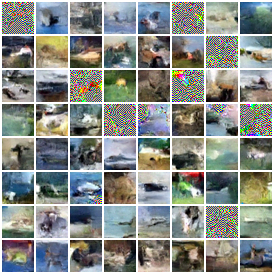 | 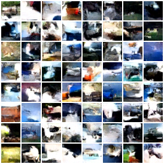 |

The final samples show varied CIFAR-like scenes (animals on grass, boats and planes against sky and water, vehicles) with no artifacts. Fine detail is limited, as expected after 23 minutes of training on a 2M-parameter U-Net (state-of-the-art CIFAR-10 diffusion models train for days with ~35M parameters).

**Through Docker** (`GET /diffusion/generate?num_images=16&seed=42`):

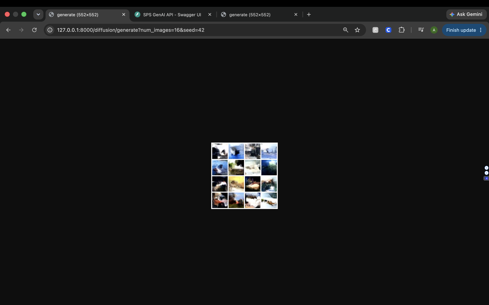

---

## Part 1b: Energy-based model

### Step 1: The energy function (77,793 parameters)

`EnergyModel` maps an image to one number, its **energy E(x)**: training makes it low for real images and high for everything else.

| Layer | Configuration | Output |
| --- | --- | --- |
| Conv2d + Swish | 3 → 16, kernel 5, stride 2, padding 2 | 16 × 16 × 16 |
| Conv2d + Swish | 16 → 32, kernel 3, stride 2, padding 1 | 32 × 8 × 8 |
| Conv2d + Swish | 32 → 64, kernel 3, stride 2, padding 1 | 64 × 4 × 4 |
| Conv2d + Swish | 64 → 64, kernel 3, stride 2, padding 1 | 64 × 2 × 2 |
| Flatten → Linear + Swish → Linear | 256 → 64 → 1 | energy (scalar) |

Swish is smooth, so the gradient of the energy **with respect to the input image**, which Langevin sampling relies on, is smooth too.

### Step 2: Sampling by Langevin dynamics, gradients on the *input*

This is the core of the assignment: instead of updating weights to lower a loss, we update the **image** to lower its energy. `langevin_sample` repeats:

1. x ← x + noise (σ = 0.005), clamped to [−1, 1]
2. x.requires_grad_(True); energy = E(x).sum()
3. ∇ₓE = torch.autograd.grad(energy, x), the gradient with respect to the **pixels**
4. x ← x − step_size · clip(∇ₓE, ±0.03), then `.detach()`

The model's weights are **frozen** during sampling (`requires_grad_(False)` on every parameter, restored afterwards), so `backward` computes only ∂E/∂x and leaves the weight gradients untouched. Detaching after each step stops the computational graph from growing across steps (Part 3, Question 8). A test confirms that after sampling the energy is lower, the images changed, and **no weight received a gradient**.

### Step 3: Training with contrastive divergence (`train_ebm`)

For each batch of real images:

1. **Negative samples:** take images from a **replay buffer** of 8,192 earlier samples (95%) or fresh uniform noise (5%), and run 60 Langevin steps on them. Continuing old chains lets samples be refined over thousands of steps in total.
2. **Loss:** L = mean E(x_real) − mean E(x_fake) + α (mean E(x_real)² + mean E(x_fake)²), α = 0.1. The first part pushes energy **down** on real images and **up** on the model's own samples (the "positive" and "negative" phases from the lecture); the regularizer keeps energies small and training stable.
3. Update the weights with Adam (lr 0.0001, betas 0.0/0.999), and write the new samples back into the buffer.

30 epochs took 23.2 minutes.

### Results

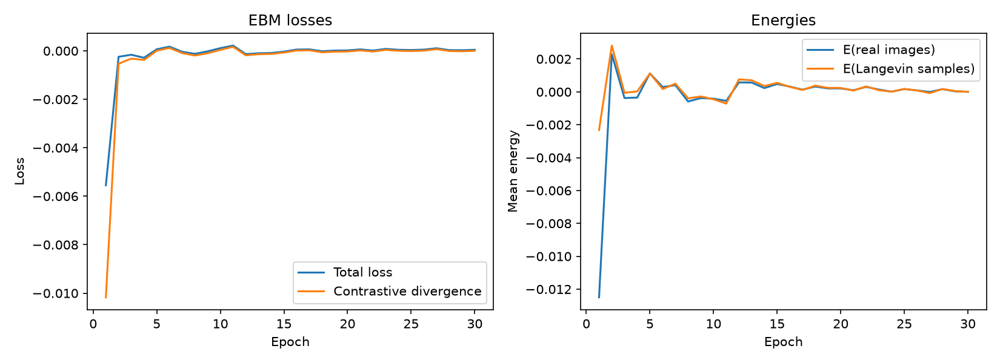

**Reading the curves.** After the first epoch, the energies of real images and Langevin samples stay almost equal and close to 0, and the contrastive divergence hovers around 0. This is the expected **equilibrium** of contrastive-divergence training rather than a failure: whenever the model separates real from fake, the next Langevin samples move into the newly lowered energy regions and close the gap, and the α-regularizer keeps all energies small. The learning shows up in the energy landscape *away* from the samples, as the energy check below demonstrates.

**Langevin sampling lowers the energy** (through Docker, 9 images from uniform noise, 200 steps):

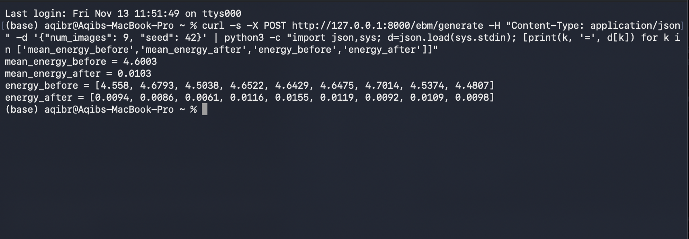

| | Mean energy | Range over 9 images |
| --- | --- | --- |
| Random noise (before) | **4.60** | 4.48 – 4.70 |
| After 200 Langevin steps | **0.0103** | 0.006 – 0.016 |

The model assigns random noise an energy about **450× higher** than its samples and real images, and gradient descent on the pixels moves every image down into the low-energy region.

**Samples from noise (200 Langevin steps), same noise at each epoch:**

| Epoch 1 | Epoch 10 | Epoch 20 | Epoch 30 |
| --- | --- | --- | --- |
| 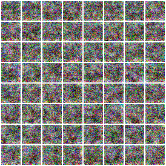 | 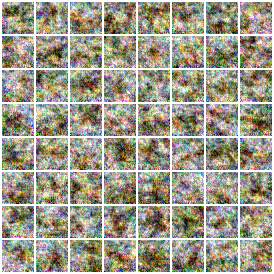 | 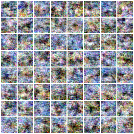 | 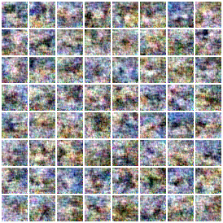 |

**Replay-buffer samples** (chains refined over many training iterations):

| Epoch 1 | Epoch 10 | Epoch 20 | Epoch 30 |
| --- | --- | --- | --- |
| 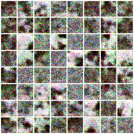 | 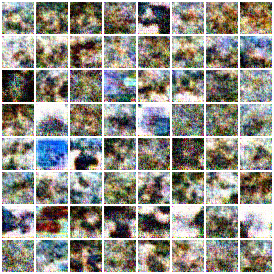 | 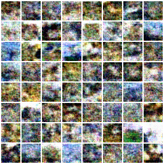 | 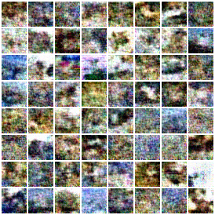 |

After epoch 1 the samples are pure static. By epochs 10–30 they have changed character: high-frequency static gives way to smoother colour regions with CIFAR-10's typical palettes (sky blues, browns, greens, whites). The buffer samples show **image-like layouts**, such as a light region above a dark one (sky over ground), blue patches like water, and blobs against a background, though without recognizable objects and still with fine-grained noise.

**Why the EBM looks much weaker than the diffusion model.** Both were trained for about 23 minutes on the same data, but they learn very differently. The diffusion model gets a direct, low-variance training signal at every pixel and noise level (predict the exact noise that was added). The EBM learns only by comparing real images with its own MCMC samples, so its signal is noisy and depends on how well the sampler mixes; short-run Langevin chains on 3,072-dimensional colour images explore slowly. This is the known weakness of EBMs, and a main reason diffusion models (which can be viewed as learning the *gradient* of the log-density at many noise levels) have replaced them for image generation. Larger energy networks, many more epochs and longer chains improve EBM samples substantially (e.g. Du & Mordatch, 2019), at a much higher compute cost.

**Through Docker** (`GET /ebm/generate?num_images=16&seed=42`):

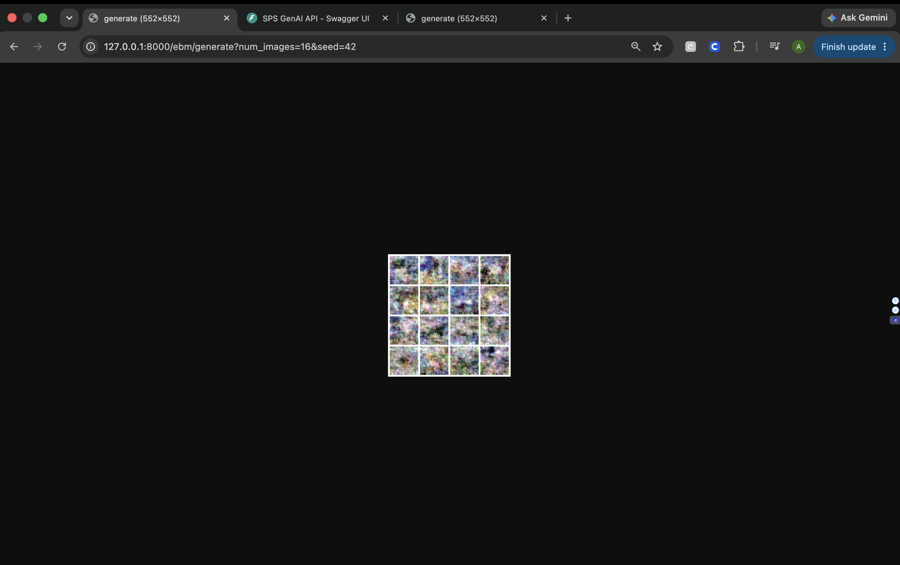

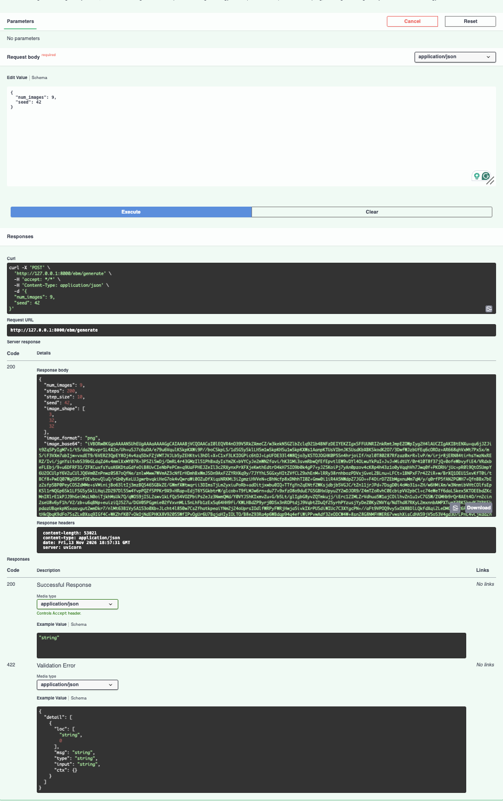

---

## Part 1c: LSTM text generator (Module 6/7 activity)

### Steps

1. **Corpus:** *The Count of Monte Cristo* (Project Gutenberg #1184), the same book as the Module 3 bigram corpus; the first 300,000 tokens. Curly apostrophes are normalized so "Albert’s" becomes `albert` + `'s` and is re-attached when the text is printed.
2. **Vocabulary:** the 10,000 most frequent tokens plus `<unk>`.
3. **Data:** windows of 30 tokens; the target is the same window shifted one word to the right (next-word prediction). The last 5% of the text is held out for validation.
4. **Model (4,771,600 parameters):** Embedding (10,000 → 128) → 2-layer LSTM (hidden 256, dropout 0.2) → Linear (256 → 10,000). This is the embedding plus `nn.LSTM` design from the Module 6 lecture.
5. **Training (`train_lstm`):** cross-entropy on every position, Adam (lr 0.002), gradient clipping at 1.0 (standard for RNNs, prevents exploding gradients), 10 epochs (1.6 minutes).
6. **Generation (`generate_with_rnn`):** feed the prompt through the LSTM, then repeatedly sample the next word from softmax(logits / temperature) (temperature 0.8) and feed it back in.

### Results

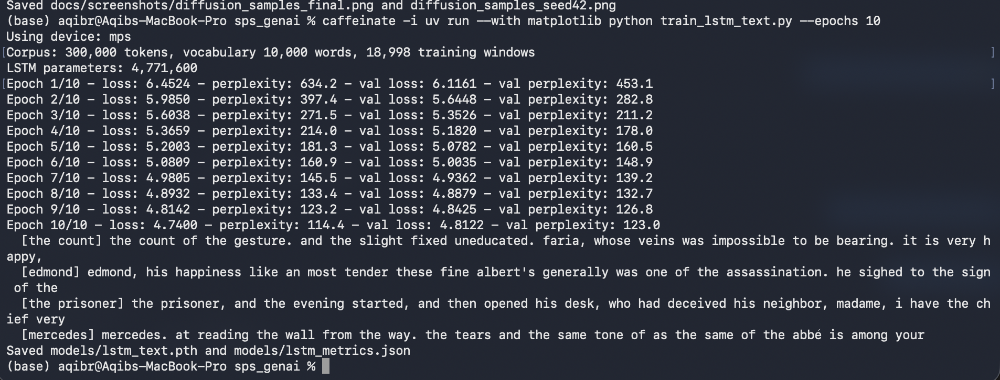

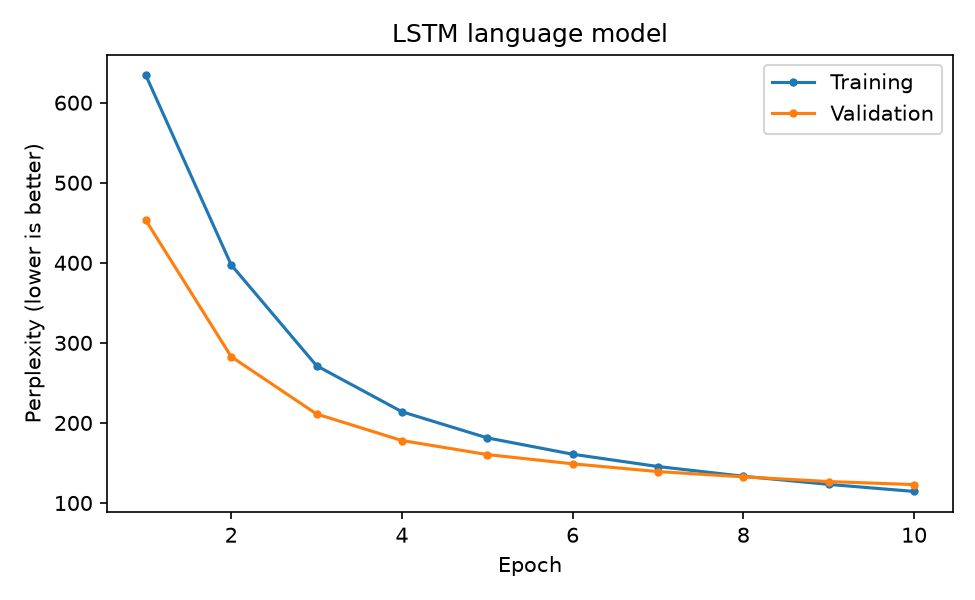

Validation **perplexity fell from 453 to 123.0**: the model went from choosing among roughly 450 equally likely words to roughly 123. Training and validation perplexity track each other closely (114 vs. 123), so the model is not overfitting. The generated text has correct local grammar and the book's vocabulary and characters ("faria", "the abbé", "albert's"), but no long-range meaning, which is typical of a small word-level LSTM trained for under two minutes.

**Through Docker** (`POST /generate_with_rnn`):

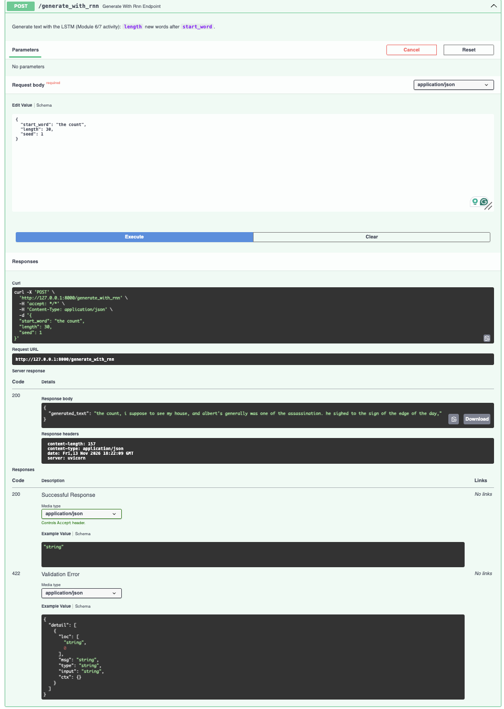

---

## Automated tests and continuous integration

[](https://github.com/aqibrahim/sps_genai/actions/workflows/ci.yml)

`uv run --with pytest pytest -v` runs **77 tests, all passing**. The Assignment 4 tests check:

- the sinusoidal embedding reproduces the Part 2, Question 2 values exactly;
- the U-Net's output shape and its resolutions 32 → 16 → 8 → 4 → 8 → 16 → 32;
- the cosine schedule (ᾱ from ≈1 down to ≈0, strictly decreasing) and the closed-form noising;
- Langevin sampling lowers the energy, changes the images, and gives **no gradients to the weights**;
- short training runs of `train_diffusion`, `train_ebm` and `train_lstm` (with the class-activity signatures);
- the Part 3 autograd answers (Questions 6–9);
- all new endpoints, including that `app/main.py` serves the `helper_lib` models.

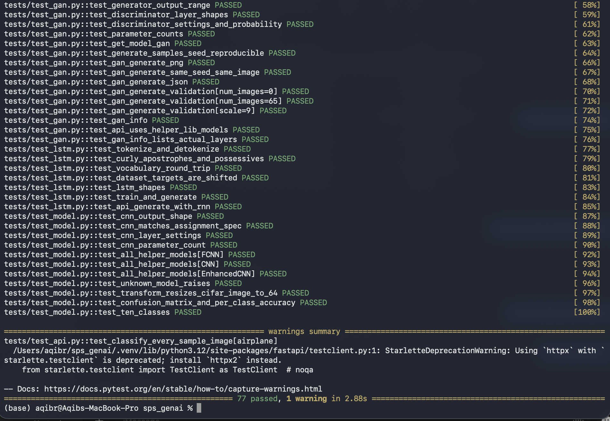

GitHub Actions also rebuilds the Docker image on x86-64 Linux on every push and queries every endpoint, including `/diffusion/generate`, `/ebm/generate` and `/generate_with_rnn`.

## Reproducing the results

```bash
uv sync
uv run --with matplotlib python train_lstm_text.py --epochs 10
uv run --with matplotlib python train_diffusion_cifar10.py --epochs 15
uv run --with matplotlib python train_ebm_cifar10.py --epochs 30
uv run --with pytest pytest -v
docker build -t sps-genai . && docker run -p 8000:80 sps-genai
```
